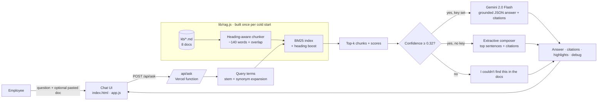
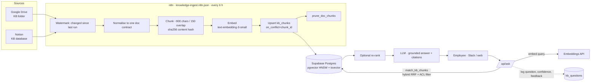

# Internal Knowledge Assistant — RAG with citations

**Ask your company docs anything and get a grounded, cited answer in under a second. When the docs don't cover it, the assistant says so.**

A retrieval-augmented (RAG) chat assistant over an internal knowledge base. Every answer cites the passages it came from, every citation opens the source with the matching sentences highlighted, and a retrieval debug view shows exactly which chunks were found, how they scored and how long each step took.

🔗 **Live demo:** https://knowledge-assistant-rag.vercel.app
📦 **Repo:** https://github.com/Saitarun29/knowledge-assistant-rag

<!--  -->
<!-- Screenshot: add docs/screenshot.png (1440×900 of the app after asking a suggested question) and uncomment the line above. -->

> The demo ships with a knowledge base for **Northwind Labs**, a fictional SaaS company: 8 realistic docs (HR leave, expenses, onboarding, security, product FAQ, pricing, incident runbook, sales playbook). It runs fully in **Demo mode** with no API key.

---

## The problem

Company knowledge sits in Google Drive, Notion and wikis. Finding "how many leave days carry over?" or "who approves a $2,000 expense?" means searching three tools, opening five docs and asking in Slack. The same questions reach People, Finance and Security teams every week. Generic chatbots make it worse: they answer confidently even when the policy says something else.

## The solution

- **Retrieval first.** Docs are chunked by heading and indexed. Each question pulls the top-k most relevant passages.
- **Grounded generation.** The LLM may use only those passages and must cite them as `[1][2]`. Citations that point outside the retrieved set are removed.
- **Honest refusals.** A confidence guard checks whether the retrieved chunks actually cover the question. If they don't, the answer is *"I couldn't find this in the docs"* and the LLM is never called.
- **Transparent.** Click a citation to read the source passage. Open **Retrieval** to see scores, query terms and latency.
- **Production ingest path.** An n8n workflow syncs Google Drive and Notion into Supabase pgvector on a schedule.

## Business impact (typical / estimated)

| Metric | Before (manual search) | With the assistant | Change |
|---|---|---|---|
| Time to find a policy answer | ~5–8 min across Drive, Notion and Slack | < 1 min, with the source linked | **~70% faster information retrieval** (typical) |
| Repeat questions to People, Finance and IT | dozens per week | most self-served | est. 40–60% fewer tickets |
| Wrong answers from outdated docs | common | cited, so they can be checked; index re-synced every 6 h | fewer escalations |

*These figures are typical of internal-knowledge RAG deployments and are estimates, not measurements from this demo. The ~70% figure matches the case study on [saitarun.com](https://saitarun.com).*

---

## Architecture

### This demo (zero dependencies, Vercel serverless)



### Production (recommended)



**How the production path differs from the demo:**

| Concern | Demo | Production |
|---|---|---|
| Corpus | 8 markdown files bundled with the function | Google Drive and Notion, synced incrementally by n8n |
| Index | In-memory BM25, rebuilt per cold start (~15 ms) | Supabase **pgvector** (HNSW, cosine) plus a Postgres full-text `tsvector` |
| Ranking | BM25 + heading boost + synonym expansion | **Hybrid**: dense + sparse merged with Reciprocal Rank Fusion (`match_kb_chunks`), optional cross-encoder re-rank |
| Freshness | Redeploy | n8n every 6 h with a watermark, content-hash upserts and pruning of stale chunks |
| Permissions | Everyone sees everything | `acl_groups` on each chunk, filtered by the caller's groups at query time |
| Observability | Debug panel | `kb_questions` log (question, found, confidence, chunks, latency, 👍/👎) for evals |

The schema, the hybrid search function and the prune function are in [`supabase/schema.sql`](supabase/schema.sql).

---

## Features

- 💬 **Chat with suggested questions** and follow-up suggestions based on the doc that answered.
- 🔢 **Inline citation chips `[1]`** plus source chips under each answer.
- 📄 **Source side panel.** The retrieved chunk opens with the cited sentences highlighted and the query terms marked. You can open the full document from there.
- 🧪 **Retrieval debug view.** Confidence vs threshold, a latency breakdown (retrieval, generation, other), stemmed and expanded query terms, out-of-vocabulary terms struck through, the top-k chunks with BM25 score bars, and index stats including whether this request was a cold start.
- 🚫 **No hallucination by design.** Low-confidence questions get "I couldn't find this in the docs" and name the closest docs. The LLM can also decline with `found: false`.
- 📚 **Docs panel** listing the whole knowledge base (owner, chunk and word counts). Click a doc to read it.
- 📝 **Bring your own text.** Paste up to 20,000 characters as a temporary doc. It stays in your browser session, is sent with each question, gets chunked and indexed with the KB for that request, and is never stored.
- 🟢 **Live AI / 🟠 Demo mode badge.** The app is fully usable without a key.
- 📱 Responsive. On phones the docs become a drawer and sources and retrieval open as a bottom sheet.

## How it works

1. **Chunking** (`lib/rag.js → chunkDoc`). Each markdown doc is split at `##` and `###` headings. Long sections are split on paragraph boundaries at ~140 words with a one-block overlap. Every chunk carries `docTitle › section`.
2. **Indexing** (`buildIndex`). Tokens are lower-cased, stop-worded and lightly stemmed. Title and heading are indexed twice as a field boost. BM25 statistics (df, idf, avgdl) are computed once per cold start and cached in module scope.
3. **Query understanding** (`expandQuery`). Stemmed terms come first, then a small domain thesaurus and phrase map (`vacation → leave, annual`, `first day → day one`, `how fast → acknowledge, response target`) at a 0.45 weight.
4. **Ranking** (`search`). BM25 (k1 = 1.4, b = 0.72) over all chunks gives the top-k (default 5).
5. **Confidence guard.** Confidence = (share of the question's idf mass covered by the best chunk) × (score saturation), × 0.6 for every out-of-vocabulary word. Unknown words like *dental* or *wifi* are usually the real subject of an out-of-scope question. Below **0.32** the API refuses.
6. **Answering.**
   - **Live** (`GEMINI_API_KEY` set): Gemini 2.0 Flash gets the numbered chunks and strict rules (only these passages, cite every sentence, `found: false` if absent) and returns JSON. Citations outside the retrieved set are stripped.
   - **Demo** (no key, or the LLM call fails): an extractive composer splits chunks into sentences, bullets and table rows (rows become "Header: value" sentences). It scores them by query-term idf, heading context and answer type ("how many…" wants a number, "who…" wants a role, "$2,000" wants the range that contains it), then writes a lead sentence plus supporting bullets, each cited.
7. **Highlights.** The sentences used are returned per citation, and the UI highlights them in the source panel.

### API

`POST /api/ask`

```json
{ "question": "Who approves an expense of $2,000?", "userDoc": { "title": "optional", "text": "optional, ≤ 20k chars" }, "topK": 5 }
```

Returns `mode` (`live` or `demo`), `found`, `answer` (with `[n]` markers), `citations[]`, `chunks[]` (n, id, docTitle, section, text, score, coverage, matchedTerms), `highlights{n: sentences[]}`, and `debug` (query terms, expanded and unknown terms, confidence, threshold, ranker, generator, latency, index stats).

`GET /api/docs` lists the docs plus `mode`. `GET /api/docs?id=pricing` returns one doc's markdown and its chunk list.

Guards: question ≤ 500 chars, pasted doc ≤ 20,000 chars, body ≤ 60 KB, 30 requests/min per IP per instance, 12 s LLM timeout with demo fallback. The key never leaves the server.

## Tech stack

- **Front end:** static `index.html` + vanilla JS (ES module) + CSS. Inter. No framework, no build step.
- **Back end:** Vercel Node.js serverless functions (`api/*.js`, ESM, no npm dependencies).
- **Retrieval:** hand-written BM25, chunker and extractive composer (`lib/rag.js`).
- **LLM (optional):** Google Gemini 2.0 Flash via REST with JSON output.
- **Production ingest:** n8n, then OpenAI embeddings, then Supabase Postgres + pgvector.

## Project structure

```
├── index.html               # UI shell
├── assets/style.css         # design system (light, Inter, purple accent)
├── assets/app.js            # chat, citations, source viewer, debug view, temp doc
├── api/ask.js               # retrieval + guard + live/demo answering
├── api/docs.js              # KB listing / single doc
├── lib/rag.js               # chunking, BM25, confidence, extractive answers
├── kb/*.md                  # Northwind Labs sample knowledge base (8 docs)
├── n8n/knowledge-ingest.n8n.json   # production ingest workflow
├── supabase/schema.sql      # pgvector schema + hybrid search + prune
└── scripts/                 # dev-server.mjs (no-CLI local server), smoke.mjs (API tests)
```

## Run locally

```bash
git clone https://github.com/Saitarun29/knowledge-assistant-rag
cd knowledge-assistant-rag
npx vercel dev            # http://localhost:3000
```

No Vercel CLI? `node scripts/dev-server.mjs` serves the same app with zero dependencies. `node scripts/smoke.mjs` runs the API handlers against 19 sample questions, including out-of-scope ones that must be refused.

To try live mode locally: `GEMINI_API_KEY=your_key npx vercel dev`.

## Deploy

[](https://vercel.com/new/clone?repository-url=https://github.com/Saitarun29/knowledge-assistant-rag&env=GEMINI_API_KEY)

Zero config: Vercel serves the static files and the `api/` functions. `vercel.json` adds `kb/` and `lib/` to the function bundle. Without `GEMINI_API_KEY` the deployment runs in Demo mode.

## Environment variables

| Variable | Where | Required | Purpose |
|---|---|---|---|
| `GEMINI_API_KEY` | Vercel | No | Enables Live AI answers (Gemini 2.0 Flash). Without it: extractive Demo mode |
| `KB_DRIVE_FOLDER_ID` | n8n | Prod | Google Drive folder that holds the KB Google Docs |
| `NOTION_TOKEN`, `NOTION_KB_DATABASE_ID` | n8n | Prod | Notion integration token and KB database |
| `OPENAI_API_KEY` | n8n | Prod | Embeddings (`text-embedding-3-small`) |
| `SUPABASE_URL`, `SUPABASE_SERVICE_ROLE_KEY` | n8n | Prod | Upserts into pgvector |

## n8n workflow: production ingest

[`n8n/knowledge-ingest.n8n.json`](n8n/knowledge-ingest.n8n.json) is an importable workflow with 19 nodes plus a sticky note that explains it:

```
Schedule (6 h) / Manual ─► Get watermark ─┬─► Drive: list changed docs ─► Split ─► Export as text ─► Normalise ─┐
                                          └─► Notion: query changed pages ─► Split ─► Get blocks ─► Normalise ─┴─► Merge
  ─► Chunk (heading-aware, 900/150, sha256) ─► Embed (OpenAI, batched, retry) ─► Attach vectors
  ─► Upsert kb_chunks (on_conflict=chunk_id) ─► Group ids per doc ─► prune_doc_chunks RPC ─► Save watermark + summary
```

1. Run `supabase/schema.sql` in the Supabase SQL editor.
2. In n8n: **Workflows → Import from file**, then attach a *Google Drive OAuth2* credential to the two Drive HTTP nodes.
3. Set the env vars above on your n8n instance, plus `NODE_FUNCTION_ALLOW_BUILTIN=crypto` for the chunker's hashing.
4. Run it once manually, then activate it. Only docs changed since the last successful run are re-embedded.

To use only one source, delete the other branch. Credentials are never stored in the file; everything is read from `$env`.

## Roadmap

- [ ] Swap BM25 for hybrid pgvector search behind the same `/api/ask` contract (`match_kb_chunks`)
- [ ] Cross-encoder re-ranking and a query rewriter for multi-turn follow-ups
- [ ] Slack bot (`/ask`) with the same citations as threaded replies
- [ ] Per-group access control end-to-end (Okta groups → `acl_groups`)
- [ ] Eval harness: golden Q&A set, retrieval recall@k, groundedness and refusal accuracy in CI
- [ ] 👍/👎 feedback stored in `kb_questions` to surface missing or outdated docs to their owners
- [ ] PDF / DOCX upload as temporary sources

## Author

**Sai Tarun Ronanki**, AI Systems & Agentic Workflows Builder, Hyderabad

- 🌐 [saitarun.com](https://saitarun.com)
- 💼 [linkedin.com/in/ronanki-sai-tarun](https://linkedin.com/in/ronanki-sai-tarun)
- 𝕏 [@SaiTarunRonanki](https://x.com/SaiTarunRonanki) · 📸 [@tarunaistudio](https://instagram.com/tarunaistudio)
- 🐙 [github.com/Saitarun29](https://github.com/Saitarun29)
- ✉️ hello@saitarun.com

**Want this over your own docs?** [Discuss your workflow on WhatsApp](https://wa.me/918008941430?text=Hello%20Sai%20Tarun%20Ronanki,%20I%20want%20to%20discuss%20about%20my%20workflow)

---

MIT © 2026 Sai Tarun Ronanki · Northwind Labs and all sample documents are fictional.
