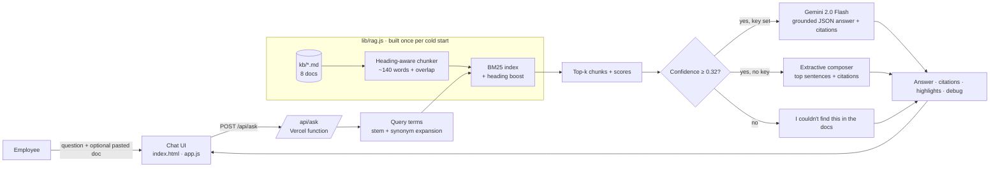

<div align="center">

<h1>Internal Knowledge Assistant</h1>

<p>Ask your company docs a question and get a cited answer, or a clear "not in the docs".</p>

<p>
  <a href="https://knowledge-assistant-rag-phi.vercel.app"></a>
  <a href="n8n/knowledge-ingest.n8n.json"></a>
  <a href="LICENSE"></a>
  
  
</p>

<p>
  <a href="https://knowledge-assistant-rag-phi.vercel.app"><b>Live demo</b></a> ·
  <a href="#n8n-workflow"><b>n8n workflow</b></a> ·
  <a href="#how-it-works"><b>Architecture</b></a> ·
  <a href="#run-locally"><b>Run locally</b></a>
</p>

</div>

## Overview

Company policy lives across Drive, Notion and wikis, so the same questions reach People, Finance and Security every week, and generic chatbots answer confidently even when the policy says otherwise. This assistant retrieves the relevant passages first, answers only from them with inline citations, and refuses when the docs do not cover the question.

The demo runs on a fictional company, Northwind Labs, with 8 sample docs (leave, expenses, onboarding, security, product FAQ, pricing, incident runbook, sales playbook). It works fully in demo mode with no API key.

## Highlights

- **Cited by default.** Every answer carries `[n]` citations; each opens the source chunk with the cited sentences highlighted.
- **Honest refusals.** A confidence guard (threshold 0.32) returns "I couldn't find this in the docs" without calling the LLM.
- **Retrieval debug view.** Confidence vs threshold, latency breakdown, expanded query terms and top-k chunks with BM25 scores.
- **Bring your own text.** Paste up to 20,000 characters as a temporary doc, indexed per request and never stored.
- **Works without a key.** Demo mode uses an extractive composer; set `GEMINI_API_KEY` for live answers.
- **Production ingest path.** An n8n workflow syncs Drive and Notion into Supabase pgvector every 6 hours.

## How it works



1. **Chunk.** Docs split at `##` and `###` headings, long sections at ~140 words with one-block overlap.
2. **Index.** Tokens are stemmed and stop-worded; title and heading are boosted. BM25 stats are cached per cold start.
3. **Expand and rank.** A small domain thesaurus adds synonyms at 0.45 weight; BM25 (k1 = 1.4, b = 0.72) returns the top-k (default 5, max 8).
4. **Guard.** Confidence combines idf coverage and score saturation, scaled by 0.6 per out-of-vocabulary word. Below 0.32 the API refuses.
5. **Answer.** Gemini 2.0 Flash returns grounded JSON (citations outside the retrieved set are stripped), or the extractive composer answers in demo mode or when the LLM call fails.

In production, the in-memory BM25 index is replaced by hybrid search in Supabase (pgvector HNSW plus `tsvector`, merged with Reciprocal Rank Fusion in `match_kb_chunks`), with `acl_groups` filtering and a `kb_questions` log. See [`supabase/schema.sql`](supabase/schema.sql).

## Business impact

Typical and estimated, not measured from this demo.

| Metric | Manual search | With the assistant |
|---|---|---|
| Time to find a policy answer | ~5 to 8 min across Drive, Notion and Slack | under 1 min, source linked (~70% faster, typical) |
| Repeat questions to People, Finance and IT | dozens per week | est. 40 to 60% fewer tickets |
| Wrong answers from outdated docs | common | cited and checkable, index re-synced every 6 h |

## Tech stack

| Layer | Tools |
|---|---|
| Front end | Static `index.html`, vanilla JS (ES module), CSS. No framework, no build step |
| Back end | Vercel Node.js serverless functions (`api/*.js`), no npm dependencies |
| Retrieval | Hand-written chunker, BM25 and extractive composer (`lib/rag.js`) |
| LLM (optional) | Google Gemini 2.0 Flash via REST, JSON output |
| Production ingest | n8n, OpenAI `text-embedding-3-small`, Supabase Postgres + pgvector |

## Project structure

```
├── index.html                      # UI shell
├── assets/
│   ├── style.css                   # design system
│   └── app.js                      # chat, citations, source viewer, debug view, temp doc
├── api/
│   ├── ask.js                      # retrieval, guard, live/demo answering
│   └── docs.js                     # KB listing and single doc
├── lib/rag.js                      # chunking, BM25, confidence, extractive answers
├── kb/*.md                         # Northwind Labs sample knowledge base (8 docs)
├── n8n/knowledge-ingest.n8n.json   # production ingest workflow
├── supabase/schema.sql             # pgvector schema, hybrid search, prune
└── scripts/                        # dev-server.mjs (local server), smoke.mjs (API tests)
```

## Run locally

```bash
git clone https://github.com/Saitarun29/knowledge-assistant-rag
cd knowledge-assistant-rag
node scripts/dev-server.mjs     # zero dependencies, demo mode
```

Or use `npx vercel dev` (http://localhost:3000). `node scripts/smoke.mjs` runs the API against 19 sample questions, including out-of-scope ones that must be refused. For live mode: `GEMINI_API_KEY=your_key npx vercel dev`.

**API.** `POST /api/ask` with `{ "question", "userDoc"?: { "title", "text" }, "topK"? }` returns `mode`, `found`, `answer`, `citations`, `chunks`, `highlights` and `debug`. `GET /api/docs` lists the KB; `GET /api/docs?id=pricing` returns one doc. Limits: question 500 chars, pasted doc 20,000 chars, body 60 KB, 30 requests per minute per IP per instance, 12 s LLM timeout with demo fallback.

## Configuration

| Variable | Required | Purpose |
|---|---|---|
| `GEMINI_API_KEY` | No | Enables live answers with Gemini 2.0 Flash. Without it, demo mode |
| `KB_DRIVE_FOLDER_ID` | n8n, prod | Google Drive folder holding the KB Google Docs |
| `NOTION_TOKEN`, `NOTION_KB_DATABASE_ID` | n8n, prod | Notion integration token and KB database |
| `OPENAI_API_KEY` | n8n, prod | Embeddings (`text-embedding-3-small`) |
| `SUPABASE_URL`, `SUPABASE_SERVICE_ROLE_KEY` | n8n, prod | Upserts into pgvector |

## n8n workflow

[`n8n/knowledge-ingest.n8n.json`](n8n/knowledge-ingest.n8n.json) has 19 nodes plus a sticky note. Every 6 hours it pulls docs changed since the last run from Drive and Notion, chunks them (~900 chars, 150 overlap, sha256 hash), embeds them, upserts `kb_chunks` and prunes stale chunks.

1. Run `supabase/schema.sql` in the Supabase SQL editor.
2. In n8n, **Workflows → Import from file**, then attach a Google Drive OAuth2 credential to the two Drive HTTP nodes.
3. Set the env vars above, plus `NODE_FUNCTION_ALLOW_BUILTIN=crypto`.
4. Run once manually, then activate. Only changed docs are re-embedded. To use one source, delete the other branch.

## Deploy

[](https://vercel.com/new/clone?repository-url=https://github.com/Saitarun29/knowledge-assistant-rag&env=GEMINI_API_KEY)

Zero config: `vercel.json` bundles `kb/` and `lib/` with the functions, and without `GEMINI_API_KEY` it runs in demo mode.

## Roadmap

- Hybrid pgvector search behind the same `/api/ask` contract (`match_kb_chunks`)
- Cross-encoder re-ranking and a query rewriter for follow-ups
- Slack bot (`/ask`) with threaded, cited replies
- Eval harness: golden Q&A set, recall@k, groundedness and refusal accuracy in CI

---

<div align="center">

Built by **Sai Tarun Ronanki** · AI Systems & Agentic Workflows Builder · Hyderabad

[saitarun.com](https://saitarun.com) · [LinkedIn](https://linkedin.com/in/ronanki-sai-tarun) · [X](https://x.com/SaiTarunRonanki)

**[Discuss your workflow →](https://wa.me/918008941430?text=Hello%20Sai%20Tarun%20Ronanki,%20I%20want%20to%20discuss%20about%20my%20workflow)**

MIT © 2026 Sai Tarun Ronanki · Northwind Labs and all sample documents are fictional.

</div>
